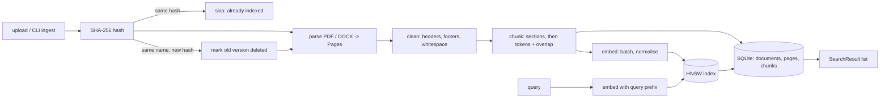

# ARCHITECTURE - Cornerstone Stage 1 (source of truth)

If code and this file disagree, fix this file first and log why in NOTES.md.

## 1. Pipeline



Order inside `ingest_file()` (crash safety): write SQLite rows with `status='pending'` -> add vectors to index -> save index -> flip rows to `status='active'`. Rows still `pending` on load = interrupted ingest (see 4.5).

## 2. Data schemas

All are `@dataclass` in `src/cornerstone/__init__.py`.

**Document**
| field | type | note |
|---|---|---|
| doc_id | int | SQLite PK |
| file_name | str | base name, unique among `active` docs |
| sha256 | str | hex digest of file bytes |
| file_type | str | `pdf` or `docx` |
| n_pages | int | PDF pages, or number of DOCX sections |
| n_pages_text / n_pages_flagged | int | indexed vs flagged |
| n_chunks | int | |
| status | str | `pending`, `active`, `replaced` |
| ingested_at | str | ISO-8601 UTC |

**Page** (extraction unit. PDF: one physical page. DOCX: one heading-delimited section, because DOCX has no pages)
| field | type | note |
|---|---|---|
| page_id | int or None | SQLite PK, set on store |
| doc_id | int or None | |
| page_no | int or None | 1-based PDF page. **None for DOCX, never invented** |
| para_start, para_end | int or None | 0-based paragraph range (DOCX only) |
| text | str | cleaned text |
| headings | list[Heading] | `Heading(text, level, line_no)`; `line_no` indexes `text.split("\n")` found in this page |
| status | str | `ok`, `needs_ocr`, `empty`, `error` |
| reason | str or None | required when status != `ok` |

**Chunk**
| field | type | note |
|---|---|---|
| chunk_id | int | SQLite PK **and** index label |
| doc_id | int | |
| file_name | str | denormalised for fast display |
| page_start, page_end | int or None | PDF only |
| para_start, para_end | int or None | DOCX only |
| section_heading | str or None | nearest preceding heading |
| chunk_index | int | 0-based position within the document |
| token_count | int | embedding-model tokenizer |
| text | str | |
| deleted | bool | soft-delete flag |

**SearchResult**: `chunk: Chunk`, `score: float` (cosine, -1..1), `rank: int` (1-based), `snippet: str` (first `snippet_chars` of text).

**IngestReport**: `file_name, status ('indexed'|'skipped_duplicate'|'replaced'|'failed'), doc_id, pages_total, pages_with_text, pages_flagged, flagged_reasons: dict[int|None, str], chunks_created, seconds, message`.

**Exceptions** (all subclass `CornerstoneError`): `UnsupportedFileType`, `EmptyFile`, `CorruptFile`, `PasswordProtected`, `ModelMismatch`, `IndexOutOfSync`, `EmptyQuery`.

## 3. SQLite (`data/index/cornerstone.sqlite`)

```
documents(doc_id INTEGER PK AUTOINCREMENT, file_name TEXT, sha256 TEXT UNIQUE-ish, file_type TEXT,
          n_pages INT, n_pages_text INT, n_pages_flagged INT, n_chunks INT,
          status TEXT, ingested_at TEXT)
pages(page_id INTEGER PK AUTOINCREMENT, doc_id INT FK, page_no INT NULL, para_start INT NULL, para_end INT NULL,
      status TEXT, reason TEXT NULL, n_chars INT)
chunks(chunk_id INTEGER PK AUTOINCREMENT, doc_id INT FK, page_start INT NULL, page_end INT NULL,
       para_start INT NULL, para_end INT NULL, section_heading TEXT NULL,
       chunk_index INT, token_count INT, text TEXT, deleted INT DEFAULT 0)
indexes: chunks(doc_id), documents(file_name), documents(sha256)
```
- `AUTOINCREMENT` guarantees a `chunk_id` is **never reused**, so a label in the index always refers to exactly one chunk, even after deletes.
- **ID mapping**: `chunk_id` (SQLite) == label in the HNSW index (`IndexIDMap`). Search returns labels -> `SELECT ... WHERE chunk_id IN (...)`.
- Page text is not stored in `pages` (it is in chunks); only status/reason/size, to answer "was every page indexed or flagged?".

## 4. Public contracts

### 4.1 `ingest/pdf_parser.py`, `ingest/docx_parser.py`, `ingest/loader.py`
```python
def extract_pdf(path: Path, cfg: dict) -> list[Page]
def extract_docx(path: Path, cfg: dict) -> list[Page]
def load_document(path: Path, cfg: dict) -> list[Page]   # dispatch by extension, then clean
```
- Returns one Page per PDF page (including flagged ones). Never drops a page silently.
- Fewer than `scan_min_chars` chars and the page has an image -> `needs_ocr` (text kept, reason set). Zero text and no image -> `empty` (blank page, reason set). Short text with no image stays `ok`. Headings: lines whose font size >= body size x `heading_size_ratio` (body = size carrying most characters in the document), level = rank of size (max 3).
- Errors: `UnsupportedFileType` (not .pdf/.docx), `EmptyFile` (0 bytes), `CorruptFile` (parser fails), `PasswordProtected` (PDF needs password). A per-page exception becomes Page(status=`error`, reason=exception text), not a crash.
- Multi-column: PyMuPDF block order (`sort=True`) is used; reading order is best-effort, documented limitation.
- Non-English text is **unsupported**: not detected or rejected in Stage 1, results are undefined.

### 4.2 `ingest/cleaner.py`
```python
def clean_pages(pages: list[Page], cfg: dict) -> list[Page]
def normalise_text(text: str) -> str
```
- Removes lines repeated (after digit-normalisation) in the top/bottom band of >= `header_footer_min_frac` of pages (needs >= 3 pages), and bare page numbers ("12", "Page 3 of 10").
- `normalise_text`: collapse runs of spaces/tabs, join hyphenated line breaks, collapse >2 blank lines, strip zero-width chars. Uses NFC, **not** NFKC, so maths symbols are kept; ligatures (fi, fl) are expanded to letters only if they appear as single code points (U+FB01...), never dropped.
- Idempotent: `normalise_text(normalise_text(x)) == normalise_text(x)`.

### 4.3 `chunking.py`
```python
def chunk_pages(pages: list[Page], doc_id: int, file_name: str, cfg: dict, count_tokens: Callable[[str], int]) -> list[Chunk]
```
- Only `ok` pages are chunked. Sections split at headings first; a section longer than `target_tokens` is split on paragraph then sentence boundaries into windows of `target_tokens` with `overlap_tokens` overlap. Nothing is truncated; a single sentence over `hard_max_tokens` is split by words.
- Fragments `< min_tokens` (e.g. a lone heading) are merged into the next chunk (or previous if last).
- No headings: whole document is treated as one section; `section_heading=None`.
- `chunk_id` is `0` here and assigned by the store at insert time. `chunk_index` is contiguous from 0.
- Empty input -> `[]`.

### 4.4 `embeddings.py`
```python
class Embedder:
    def __init__(self, cfg: dict) -> None                 # loads model once (CPU)
    def embed_passages(self, texts: list[str]) -> np.ndarray   # (n, dim) float32, L2-normalised
    def embed_query(self, text: str) -> np.ndarray              # (dim,) float32, adds query_prefix
    def count_tokens(self, text: str) -> int
```
- Processes in batches of `batch_size`; memory bounded. Empty list -> `(0, dim)` array.
- `embed_query` raises `EmptyQuery` for empty/whitespace; truncates to `max_query_chars`.
- Passage prefix is `""` for bge-small (only queries get the prefix).

### 4.5 `index/hnsw_index.py`, `index/manifest.py`, `index/metadata_store.py`
```python
class HNSWIndex:
    def __init__(self, dim: int, M: int, ef_construction: int, ef_search: int)
    def add(self, ids: np.ndarray, vectors: np.ndarray) -> None   # incremental, never rebuilds
    def search(self, query: np.ndarray, k: int, ef_search: int | None = None) -> tuple[np.ndarray, np.ndarray]  # (labels, scores), -1 padded dropped
    def save(self, path: Path) -> None
    @classmethod
    def load(cls, path: Path, manifest: Manifest) -> "HNSWIndex"   # raises ModelMismatch
    def __len__(self) -> int
```
- faiss `IndexIDMap(IndexHNSWFlat(dim, M, METRIC_INNER_PRODUCT))`. Inner product on unit vectors == cosine.
- Search uses `ef = max(ef_search, k)`. `k > len(index)` -> returns `len(index)` results. Empty index -> empty arrays (no exception).
- Deleted chunks stay in the graph; the caller (`search.py`) filters them via SQLite and over-fetches (doubling `k'` until `k` live hits or `k' >= len`).

```python
@dataclass class Manifest: model_name, model_revision, dimension, space, normalized, created_at, index_version
def write_manifest(path, m) / read_manifest(path) -> Manifest
def check_manifest(m: Manifest, cfg: dict) -> None   # raises ModelMismatch with a clear message
```

```python
class MetadataStore:
    def __init__(self, db_path: Path)
    def find_by_hash(self, sha256: str) -> Document | None
    def find_active_by_name(self, file_name: str) -> Document | None
    def add_document(self, doc: Document, pages: list[Page], chunks: list[Chunk]) -> list[int]   # returns chunk_ids
    def activate(self, doc_id: int) -> None
    def mark_replaced(self, doc_id: int) -> None            # sets chunks.deleted = 1
    def get_chunks(self, chunk_ids: list[int]) -> dict[int, Chunk]   # only non-deleted
    def stats(self) -> dict
    def check_sync(self, index_ids: set[int]) -> list[str]   # human-readable problems, [] if consistent
```

### 4.6 `pipeline.py`
```python
def ingest_file(path: Path, cfg: dict, store: MetadataStore, index: HNSWIndex, embedder: Embedder,
                progress: Callable[[str], None] | None = None) -> IngestReport
```
- Steps: hash -> duplicate check -> (replace) -> load_document -> chunk -> embed (batched, progress callback) -> store pending -> index.add -> save -> activate.
- Same hash as an active doc -> `skipped_duplicate`, nothing written. Same file name, different hash -> new version indexed, old version `replaced` and its chunks `deleted=1`.
- Unsupported/empty/corrupt/password-protected -> `IngestReport(status='failed', message=...)`, nothing written. Never raises for a bad *file*; does raise for bad config or `ModelMismatch`.
- A doc where all pages are flagged is stored (with its flags) with 0 chunks and reported, not hidden.

### 4.7 `search.py`
```python
def search(query: str, k: int, cfg: dict, store: MetadataStore, index: HNSWIndex, embedder: Embedder,
           ef_search: int | None = None) -> list[SearchResult]
```
- Empty/whitespace query -> `EmptyQuery`. Empty index -> `[]`. `k < 1` -> `ValueError`. Results sorted by score desc, deleted/replaced never returned.

### 4.8 `cli.py`
```
python -m cornerstone.cli ingest <path|dir> [--force-model-check]
python -m cornerstone.cli search "<query>" [-k 5]
python -m cornerstone.cli stats
python -m cornerstone.cli chunks <file>      # debug: print chunks of one file (Step 2)
```
Exit code 0 on success, 1 on failure; failed files are listed, never swallowed.

## 5. Configuration (`config.yaml`) and reasons

| key | value | reason |
|---|---|---|
| embedding.model_name | BAAI/bge-small-en-v1.5 | 33M params (~130 MB), 384-dim, strong English retrieval for its size, runs on CPU in <8 GB. Alternative all-MiniLM-L6-v2 is smaller but weaker on retrieval benchmarks and has a 256-token window. |
| embedding.dimension | 384 | fixed by model; stored in manifest |
| embedding.query_prefix | "Represent this sentence for searching relevant passages: " | recommended by the model card for short queries; not used for passages |
| chunking.target_tokens | 256 | well under the 512 window; big enough for one idea (a paragraph or two), small enough that a hit points to a precise page |
| chunking.overlap_tokens | 48 (~19%) | keeps a sentence that straddles a boundary retrievable from at least one chunk |
| chunking.min_tokens | 40 | avoids chunks that are only a heading |
| chunking.hard_max_tokens | 480 | safety margin below 512 so truncation never happens |
| hnsw.M | 16 | links per node; standard default, ~64 B/vector graph overhead for 384-d floats is negligible |
| hnsw.ef_construction | 200 | build-time search width; higher = better graph, slower build. Corpus is small so cost is trivial |
| hnsw.ef_search | 50 | query-time width; must be >= k. Verified in Step 6 by sweep at 10/50/100 |
| search.default_k | 5 | hit@5 is the evaluation metric |

## 6. Index manifest (`data/index/manifest.json`)
`model_name`, `model_revision`, `dimension`, `space` (`cosine`), `normalized` (true), `created_at`, `index_version`. Written at first ingest. `HNSWIndex.load` and `ingest_file` call `check_manifest(...)`; any mismatch of model name, revision, dimension, space or normalisation raises `ModelMismatch` ("index was built with X (dim D); config says Y (dim E); re-index or change config").

## 7. Toolchain (version lock)

| item | value |
|---|---|
| OS | Windows 11 Home x64 (10.0.26340) |
| CPU / RAM | Intel i5-1135G7, 4 cores; 8 GB (7.74 usable); no CUDA |
| Python | 3.12.10 (`.venv`; system Python 3.14.0 not used) |
| PyMuPDF | 1.28.2 |
| python-docx | 1.2.0 |
| sentence-transformers | 6.1.0 |
| transformers | 5.19.0 |
| torch (CPU) | 2.14.1+cpu |
| faiss-cpu | 1.15.1 |
| numpy | 2.5.4 |
| PyYAML | 6.0.3 |
| streamlit | 1.66.0 |
| pytest | 9.1.1 |
| huggingface_hub | 1.33.0 |
| embedding model | BAAI/bge-small-en-v1.5, revision 5c38ec7c405ec4b44b94cc5a9bb96e735b38267a |
| git / gh | 2.53.0 / 2.102.0 |

hnswlib was rejected: no Windows wheel for Python 3.12 and no C++ compiler (NOTES.md 2026-10-15).

## 8. Edge-case table

| case | behaviour | where tested |
|---|---|---|
| unsupported type / empty / corrupt / password PDF | `failed` report with message, nothing written | test_loader |
| scanned page | page `needs_ocr` + reason, counted in report and stats | test_pdf_parser |
| repeated header/footer, page numbers | removed | test_cleaner |
| ligatures, maths symbols | preserved | test_cleaner |
| non-English | unsupported, documented, not detected | - |
| 300+ pages | per-page streaming, batched embeddings, progress callback | test_pipeline |
| duplicate / replaced | skip / replace + soft-delete | test_pipeline |
| long section, tiny fragment, no headings | split with overlap / merged / one section | test_chunking |
| search on empty index, k > N, ef < k | `[]` / N results / `ef = max(ef, k)` | test_search, test_index |
| deleted docs | never returned | test_search |
| crash mid-ingest | `pending` rows or label mismatch -> `IndexOutOfSync` on load, `stats` reports it, `--rebuild` offered | test_pipeline |
| model/dim mismatch | `ModelMismatch` | test_manifest |
| empty / huge query | `EmptyQuery` / truncated to `max_query_chars` | test_search |

## 9. Stage 2 extension points
- **Generation / citations**: consume `list[SearchResult]` from `search()`; each has file, page/section, text. No index change.
- **Reranking**: wrap `search()`: fetch k=50, rerank with a cross-encoder on `chunk.text`, return top 5. Same `SearchResult` type.
- **BM25 / hybrid**: second retriever over `chunks.text` (SQLite FTS5); merge ranks (RRF) in a new `hybrid_search()`.
- **OCR**: pages with `status='needs_ocr'` are already stored; an OCR job fills their text and re-runs chunk + embed for that doc only.
- **Multilingual**: change `embedding.model_name`; the manifest forces a deliberate re-index.
