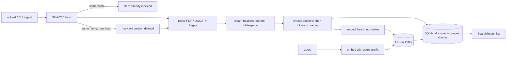
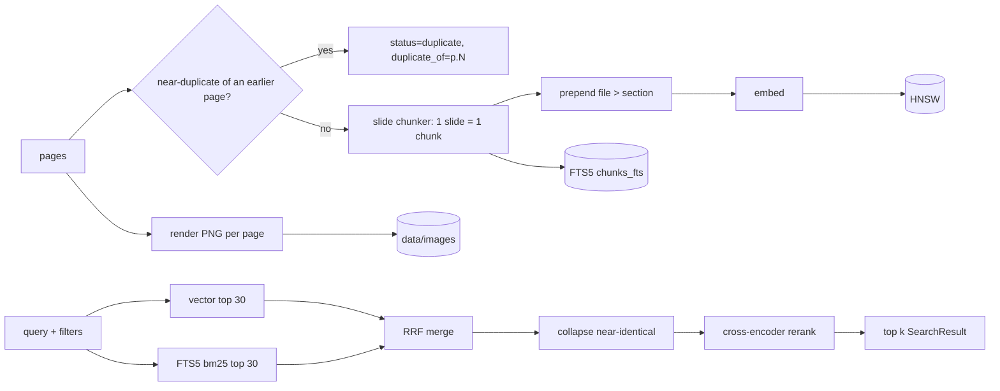

# ARCHITECTURE - Cornerstone (source of truth; sections 1-9 Stage 1, section 10+ Stage 2)

If code and this file disagree, fix this file first and log why in NOTES.md.

## 1. Pipeline



Order inside `ingest_file()` (crash safety): write SQLite rows with `status='pending'` -> add vectors to index -> save index -> flip rows to `status='active'`. Rows still `pending` on load = interrupted ingest (see 4.5).

## 2. Data schemas

All are `@dataclass` in `src/cornerstone/__init__.py`.

**Document**
| field | type | note |
|---|---|---|
| doc_id | int | SQLite PK |
| file_name | str | base name, unique among `active` docs |
| sha256 | str | hex digest of file bytes |
| file_type | str | `pdf` or `docx` |
| n_pages | int | PDF pages, or number of DOCX sections |
| n_pages_text / n_pages_flagged | int | indexed vs flagged |
| n_chunks | int | |
| status | str | `pending` (ingest in progress/interrupted), `active`, `replaced`, `abandoned` |
| ingested_at | str | ISO-8601 UTC |

**Page** (extraction unit. PDF: one physical page. DOCX: one heading-delimited section, because DOCX has no pages)
| field | type | note |
|---|---|---|
| page_id | int or None | SQLite PK, set on store |
| doc_id | int or None | |
| page_no | int or None | 1-based PDF page. **None for DOCX, never invented** |
| para_start, para_end | int or None | 0-based paragraph range (DOCX only) |
| text | str | cleaned text |
| headings | list[Heading] | `Heading(text, level, line_no)`; `line_no` indexes `text.split("\n")` found in this page |
| status | str | `ok`, `needs_ocr`, `empty`, `error` |
| reason | str or None | required when status != `ok` |

**Chunk**
| field | type | note |
|---|---|---|
| chunk_id | int | SQLite PK **and** index label |
| doc_id | int | |
| file_name | str | denormalised for fast display |
| page_start, page_end | int or None | PDF only |
| para_start, para_end | int or None | DOCX only |
| section_heading | str or None | nearest preceding heading |
| chunk_index | int | 0-based position within the document |
| token_count | int | embedding-model tokenizer |
| text | str | |
| deleted | bool | derived from SQLite `chunks.status == 'deleted'` (the column is the single source of truth: `pending` / `active` / `deleted`) |

**SearchResult**: `chunk: Chunk`, `score: float` (cosine, -1..1), `rank: int` (1-based), `snippet: str` (first `snippet_chars` of text).

**IngestReport**: `file_name, status ('indexed'|'skipped_duplicate'|'replaced'|'failed'), doc_id, pages_total, pages_with_text, pages_flagged, flagged_pages: list[(page_no|None, "status: reason")], chunks_created, seconds, message`.

**Exceptions** (all subclass `CornerstoneError`): `UnsupportedFileType`, `EmptyFile`, `CorruptFile`, `PasswordProtected`, `ModelMismatch`, `IndexOutOfSync`, `EmptyQuery`.

## 3. SQLite (`data/index/cornerstone.sqlite`)

```
documents(doc_id INTEGER PK AUTOINCREMENT, file_name TEXT, sha256 TEXT (not unique: an old version can be re-uploaded), file_type TEXT,
          n_pages INT, n_pages_text INT, n_pages_flagged INT, n_chunks INT,
          status TEXT, ingested_at TEXT)
pages(page_id INTEGER PK AUTOINCREMENT, doc_id INT FK, page_no INT NULL, para_start INT NULL, para_end INT NULL,
      status TEXT, reason TEXT NULL, n_chars INT)
chunks(chunk_id INTEGER PK AUTOINCREMENT, doc_id INT FK, page_start INT NULL, page_end INT NULL,
       para_start INT NULL, para_end INT NULL, section_heading TEXT NULL,
       chunk_index INT, token_count INT, text TEXT, status TEXT DEFAULT 'pending' CHECK in (pending, active, deleted))
unique index: documents(file_name) WHERE status = 'active'   -- at most one live version per name
indexes: chunks(doc_id), documents(file_name), documents(sha256)
```
- `AUTOINCREMENT` guarantees a `chunk_id` is **never reused**, so a label in the index always refers to exactly one chunk, even after deletes.
- **ID mapping**: `chunk_id` (SQLite) == label in the HNSW index (`IndexIDMap2`). Search returns labels -> `SELECT ... WHERE chunk_id IN (...)`.
- Page text is not stored in `pages` (it is in chunks); only status/reason/size, to answer "was every page indexed or flagged?".

## 4. Public contracts

### 4.1 `ingest/pdf_parser.py`, `ingest/docx_parser.py`, `ingest/loader.py`
```python
def extract_pdf(path: Path, cfg: dict) -> list[Page]
def extract_docx(path: Path, cfg: dict) -> list[Page]
def load_document(path: Path, cfg: dict) -> list[Page]   # dispatch by extension, then clean
```
- Returns one Page per PDF page (including flagged ones). Never drops a page silently.
- Fewer than `scan_min_chars` chars and the page has an image -> `needs_ocr` (text kept, reason set). Zero text and no image -> `empty` (blank page, reason set). Short text with no image stays `ok`. Headings: lines whose font size >= body size x `heading_size_ratio` (body = size carrying most characters in the document), level = rank of size (max 3).
- Errors: `UnsupportedFileType` (not .pdf/.docx), `EmptyFile` (0 bytes), `CorruptFile` (parser fails), `PasswordProtected` (PDF needs password). A per-page exception becomes Page(status=`error`, reason=exception text), not a crash.
- Multi-column: PyMuPDF block order (`sort=True`) is used; reading order is best-effort, documented limitation.
- DOCX: each heading starts a section Page; text before the first heading is its own Page; tables are flattened to "a | b" lines (not dropped, structure not preserved); no text at all -> one `empty` Page. Encrypted DOCX (OLE container) -> `PasswordProtected`.
- Non-English text is **unsupported**: not detected or rejected in Stage 1, results are undefined.

### 4.2 `ingest/cleaner.py`
```python
def clean_pages(pages: list[Page], cfg: dict) -> list[Page]
def normalise_text(text: str) -> str
```
- Removes lines repeated (digits and punctuation ignored, so "MITS-DU" == "MITS DU") on >= `header_footer_min_frac` (0.4) of pages (needs >= 3 pages; only lines up to `header_footer_max_chars` = 80 chars; **anywhere** on the page, because reading order can put a footer mid-text), and bare page numbers ("12", "Page 3 of 10") in the first/last `header_footer_lines` (3) lines. Skipped for DOCX sections (page_no None). A page left with no text becomes `needs_ocr` if it has an image (`Page.has_image`), else `empty`, with a reason. Headings are re-located by text after cleaning.
- `normalise_text`: collapse runs of spaces/tabs, join hyphenated line breaks, collapse >2 blank lines, strip zero-width chars. Uses NFC, **not** NFKC, so maths symbols are kept; ligature code points (U+FB00..FB06) are expanded to letters, never dropped. Private-use glyphs (U+E000..F8FF, Wingdings bullets) are removed; real bullets (U+2022 etc.) are kept.
- Idempotent: `normalise_text(normalise_text(x)) == normalise_text(x)`.

### 4.3 `chunking.py`
```python
def chunk_pages(pages: list[Page], doc_id: int, file_name: str, cfg: dict, count_tokens: Callable[[str], int]) -> list[Chunk]
```
- Only `ok` pages are chunked. Sections split at headings first; a section longer than `target_tokens` is split on paragraph then sentence boundaries into windows of `target_tokens` with `overlap_tokens` overlap. Nothing is truncated; a single sentence over `hard_max_tokens` is split by words.
- Fragments `< min_tokens` (e.g. a lone heading) are merged into the next chunk (or previous if last).
- No headings: whole document is treated as one section; `section_heading=None`.
- Overlap is whole trailing sentences/paragraphs up to `overlap_tokens`; if the last sentence alone exceeds the budget, its last words are repeated instead. Every window consumes at least one new atom, so the loop always terminates.
- A section is a run of paragraphs under one heading; the heading persists across pages until the next heading. The heading line is kept as the first line of its chunk text.
- `chunk_id` is `0` here and assigned by the store at insert time. `chunk_index` is contiguous from 0.
- Empty input -> `[]`.

### 4.4 `embeddings.py`
```python
def load_token_counter(cfg: dict) -> Callable[[str], int]   # tokenizer only (~1 MB), no model weights; used by chunking + CLI
class Embedder:
    def __init__(self, cfg: dict) -> None                 # loads model once (CPU)
    def embed_passages(self, texts: list[str]) -> np.ndarray   # (n, dim) float32, L2-normalised
    def embed_query(self, text: str) -> np.ndarray              # (dim,) float32, adds query_prefix
    def count_tokens(self, text: str) -> int
```
- Processes in batches of `batch_size`; memory bounded. Empty list -> `(0, dim)` array.
- `embed_query` raises `EmptyQuery` for empty/whitespace; truncates to `max_query_chars`.
- Passage prefix is `""` for bge-small (only queries get the prefix). `embed_passages` raises `ValueError` on an empty/blank passage (an empty chunk is a bug upstream, never embedded silently). Model weights are cached by Hugging Face in `~/.cache/huggingface` and loaded once per `Embedder`.

### 4.5 `index/hnsw_index.py`, `index/manifest.py`, `index/metadata_store.py`
```python
class HNSWIndex:
    def __init__(self, manifest: Manifest, M: int, ef_construction: int, ef_search: int)
    @classmethod
    def from_config(cls, cfg: dict) -> "HNSWIndex"              # new empty index + manifest from config
    def add(self, ids: np.ndarray, vectors: np.ndarray) -> None   # incremental, never rebuilds; ValueError on dup ids, wrong dim, non-unit or NaN vectors
    def search(self, query: np.ndarray, k: int, ef_search: int | None = None) -> tuple[np.ndarray, np.ndarray]  # (labels, scores), -1 padded dropped
    def save(self, path: Path) -> None                            # index (atomic replace) then manifest.json next to it
    @classmethod
    def load(cls, path: Path, cfg: dict) -> "HNSWIndex"          # reads manifest next to the file, check_manifest, raises ModelMismatch
    def all_ids(self) -> np.ndarray                               # every label incl. soft-deleted, for the sync check
    def vectors(self) -> tuple[np.ndarray, np.ndarray]            # (ids, matrix) in insertion order, for eval
    def __len__(self) -> int
```
- faiss `IndexIDMap2(IndexHNSWFlat(dim, M, METRIC_INNER_PRODUCT))`, vectors added with `add_with_ids` (label = chunk_id). `remove_ids` is never used (unsupported for HNSW). Inner product on unit vectors == cosine.
- Search uses `ef = max(ef_search, k)`. `k > len(index)` -> returns `len(index)` results. Empty index -> empty arrays (no exception).
- Deleted chunks stay in the graph; the caller (`search.py`) filters them via SQLite and over-fetches (doubling `k'` until `k` live hits or `k' >= len`).

```python
@dataclass class Manifest: model_name, model_revision, dimension, space, normalized, created_at, index_version
def manifest_from_config(cfg) -> Manifest; manifest_path_for(index_path) -> Path   # manifest.json beside the index
def write_manifest(path, m) / read_manifest(path) -> Manifest   # missing/corrupt manifest raises ModelMismatch
def check_manifest(m: Manifest, cfg: dict) -> None   # raises ModelMismatch with a clear message
```

```python
class MetadataStore:
    def __init__(self, db_path: Path)
    def find_by_hash(self, sha256: str) -> Document | None
    def find_active_by_name(self, file_name: str) -> Document | None
    def get_document(self, doc_id: int) -> Document | None
    def list_documents(self, status: str = "active") -> list[Document]
    def add_document(self, doc: Document, pages: list[Page], chunks: list[Chunk]) -> list[int]
        # ONE transaction: document + pages + chunks, all `pending`; returns chunk_ids in chunk order; sets doc.doc_id
    def activate(self, doc_id: int, replaces: int | None = None) -> None
        # ONE transaction: pending -> active (+ retire `replaces`); ValueError if not pending
    def mark_replaced(self, doc_id: int) -> None            # active -> replaced, its chunks -> deleted
    def discard_pending(self, doc_id: int) -> None          # interrupted ingest: pending -> abandoned, chunks -> deleted
    def get_chunks(self, chunk_ids: list[int]) -> dict[int, Chunk]   # `active` chunks only
    def active_chunk_ids(self) -> list[int]
    def stats(self) -> dict
    def check_sync(self, index_ids: set[int]) -> list[str]   # human-readable problems, [] if consistent
```
- Every multi-row write is a single SQLite transaction (`with conn:`), so a crash leaves either nothing or a complete `pending` document, never a half-written or half-active one.
- `check_sync` reports: pending documents (interrupted ingests), vectors with no SQLite row, active chunks with no vector. Soft-deleted chunks may remain in the index (not a problem).

### 4.6 `pipeline.py`
```python
def ingest_file(path: Path, cfg: dict, store: MetadataStore, index: HNSWIndex, embedder: Embedder,
                index_path: Path, progress: Callable[[str], None] | None = None) -> IngestReport
```
- Steps: hash -> duplicate check -> (find old version) -> load_document -> chunk -> embed (batched, progress callback) -> store pending -> index.add -> index.save -> activate(replaces=old). `activate` runs only after the index file is saved, so search never sees a chunk the index cannot return.
- Failure handling: a bad file fails **before any row is written**. An ordinary exception after `add_document` (disk full) triggers `discard_pending` and is re-raised; a hard crash leaves the document `pending` for `check_sync` to report. `ModelMismatch` is raised if embedder and index dimensions differ.
- Same hash as an active doc -> `skipped_duplicate`, nothing written. Same file name, different hash -> new version indexed, old version `replaced` and its chunks `deleted=1`.
- Unsupported/empty/corrupt/password-protected -> `IngestReport(status='failed', message=...)`, nothing written. Never raises for a bad *file*; does raise for bad config or `ModelMismatch`.
- A doc where all pages are flagged is stored (with its flags) with 0 chunks and reported, not hidden.

### 4.7 `search.py`
```python
def search(query: str, k: int, cfg: dict, store: MetadataStore, index: HNSWIndex, embedder: Embedder,
           ef_search: int | None = None) -> list[SearchResult]
```
- Empty/whitespace query -> `EmptyQuery` (raised even on an empty index). Empty index -> `[]`. `k < 1` -> `ValueError`. Results sorted by score desc; deleted/replaced/pending chunks never returned.
- Over-fetch: first asks the index for `3k` candidates, keeps those SQLite reports `active`, and doubles the fetch until `k` live hits or the whole index was examined (all hits deleted -> `[]`). `SearchResult(chunk, score, rank, snippet)`; the snippet is whitespace-collapsed text cut at `snippet_chars`.

### 4.8 `cli.py`
```
python -m cornerstone.cli [--config FILE] ingest <file|dir> [--yes] [-v]
python -m cornerstone.cli [--config FILE] search "<query>" [--k 5] [--yes]
python -m cornerstone.cli [--config FILE] stats [--yes]
python -m cornerstone.cli chunks <file> [--full]     # debug: print chunks of one file
```
Run with `PYTHONPATH=src`. Exit code 0 on success, 1 on failure; failed files are listed, never swallowed.
- `open_stack(cfg, root, load_embedder, assume_yes)` opens or creates `<index_dir>/hnsw.faiss` + `cornerstone.sqlite`, loads the manifest (raises `ModelMismatch`), then runs `check_sync`. Problems are printed to stderr. Interrupted ingests are discarded **only** after an interactive `y` or `--yes`; non-interactive runs report and leave them. Orphan/missing vectors print how to rebuild (delete the index folder, re-ingest).

## 5. Configuration (`config.yaml`) and reasons

| key | value | reason |
|---|---|---|
| embedding.model_name | BAAI/bge-small-en-v1.5 | 33M params (~130 MB), 384-dim, strong English retrieval for its size, runs on CPU in <8 GB. Alternative all-MiniLM-L6-v2 is smaller but weaker on retrieval benchmarks and has a 256-token window. |
| embedding.dimension | 384 | fixed by model; stored in manifest |
| embedding.query_prefix | "Represent this sentence for searching relevant passages: " | recommended by the model card for short queries; not used for passages |
| chunking.target_tokens | 256 | well under the 512 window; big enough for one idea (a paragraph or two), small enough that a hit points to a precise page |
| chunking.overlap_tokens | 48 (~19%) | keeps a sentence that straddles a boundary retrievable from at least one chunk |
| chunking.min_tokens | 40 | avoids chunks that are only a heading |
| chunking.hard_max_tokens | 480 | safety margin below 512 so truncation never happens |
| hnsw.M | 16 | links per node; standard default, ~64 B/vector graph overhead for 384-d floats is negligible |
| hnsw.ef_construction | 200 | build-time search width; higher = better graph, slower build. Corpus is small so cost is trivial |
| hnsw.ef_search | 50 | query-time width; must be >= k. Verified in Step 6 by sweep at 10/50/100 |
| search.default_k | 5 | hit@5 is the evaluation metric |

## 6. Index manifest (`data/index/manifest.json`)
`model_name`, `model_revision`, `dimension`, `space` (`cosine`), `normalized` (true), `created_at`, `index_version`. Written at first ingest. `HNSWIndex.load` and `ingest_file` call `check_manifest(...)`; any mismatch of model name, revision, dimension, space or normalisation raises `ModelMismatch` ("index was built with X (dim D); config says Y (dim E); re-index or change config").

## 7. Toolchain (version lock)

| item | value |
|---|---|
| OS | Windows 11 Home x64 (10.0.26340) |
| CPU / RAM | Intel i5-1135G7, 4 cores; 8 GB (7.74 usable); no CUDA |
| Python | 3.12.10 (`.venv`; system Python 3.14.0 not used) |
| PyMuPDF | 1.28.2 |
| python-docx | 1.2.0 |
| sentence-transformers | 6.1.0 |
| transformers | 5.19.0 |
| torch (CPU) | 2.14.1+cpu |
| faiss-cpu | 1.15.1 |
| numpy | 2.5.4 |
| PyYAML | 6.0.3 |
| streamlit | 1.66.0 |
| pytest | 9.1.1 |
| huggingface_hub | 1.33.0 |
| embedding model | BAAI/bge-small-en-v1.5, revision 5c38ec7c405ec4b44b94cc5a9bb96e735b38267a |
| git / gh | 2.53.0 / 2.102.0 |

hnswlib was rejected: no Windows wheel for Python 3.12 and no C++ compiler (NOTES.md 2026-10-15).

## 8. Edge-case table

| case | behaviour | where tested |
|---|---|---|
| unsupported type / empty / corrupt / password PDF | `failed` report with message, nothing written | test_loader |
| scanned page | page `needs_ocr` + reason, counted in report and stats | test_pdf_parser |
| repeated header/footer, page numbers | removed | test_cleaner |
| ligatures, maths symbols | preserved | test_cleaner |
| non-English | unsupported, documented, not detected | - |
| 300+ pages | per-page streaming, batched embeddings, progress callback | test_pipeline |
| duplicate / replaced | skip / replace + soft-delete | test_pipeline |
| long section, tiny fragment, no headings | split with overlap / merged / one section | test_chunking |
| search on empty index, k > N, ef < k | `[]` / N results / `ef = max(ef, k)` | test_search, test_index |
| deleted docs | never returned | test_search |
| crash mid-ingest | `pending` rows or label mismatch -> `IndexOutOfSync` on load, `stats` reports it, `--rebuild` offered | test_pipeline |
| model/dim mismatch | `ModelMismatch` | test_manifest |
| empty / huge query | `EmptyQuery` / truncated to `max_query_chars` | test_search |

## 8b. Demo UI (`app/streamlit_app.py`)
Thin layer: `open_stack` (per script run), `ingest_file` for uploads saved to `paths.raw_dir`, `search` for queries; sidebar shows `MetadataStore.stats()`; sync problems are displayed and `discard_pending` is only called from a button. No retrieval or ingestion logic in the UI. Only the `Embedder` is cached (`st.cache_resource`); SQLite connections are opened and closed per script run because they are bound to one thread and Streamlit reruns on different threads. `CORNERSTONE_CONFIG` selects another config file (used by tests).

## 9. Stage 2 extension points
- **Generation / citations**: consume `list[SearchResult]` from `search()`; each has file, page/section, text. No index change.
- **Reranking**: wrap `search()`: fetch k=50, rerank with a cross-encoder on `chunk.text`, return top 5. Same `SearchResult` type.
- **BM25 / hybrid**: second retriever over `chunks.text` (SQLite FTS5); merge ranks (RRF) in a new `hybrid_search()`.
- **OCR**: pages with `status='needs_ocr'` are already stored; an OCR job fills their text and re-runs chunk + embed for that doc only.
- **Multilingual**: change `embedding.model_name`; the manifest forces a deliberate re-index.

## 10. Stage 2 - Phase 1: retrieval quality (contracts; no code before the user's "go")

Goal: fix the v0.1 failure modes seen in Stage 1 (duplicate slides eating top-k, sections merged across slides, mis-detected headings, vector-only misses on exact terms) and give Phase 2 exact, image-backed citations. Every change below is switchable in `config.yaml` so each one gets its own ablation row on the dev split (10.10).



### 10.1 Schema version 2 and the loud failure
- `SCHEMA_VERSION = 2`, stored in SQLite `PRAGMA user_version` and in `manifest.json` `index_version`. A v0.1 database has `user_version = 0`.
- `MetadataStore.__init__` and `HNSWIndex.load` (via `check_manifest`) raise **`IndexVersionMismatch`** (subclass of `ModelMismatch`, so existing handlers still catch it) when the stored version != 2 (a v0.1 database never set `user_version`, so 0 is read as schema 1). The store closes its connection and creates nothing in the old file: "index was built with schema 1 (v0.1); this code needs schema 2. Rebuild: python -m cornerstone.cli rebuild <files or folder> --yes (the old index is kept as data/index.v1.bak)". `open_stack` prints it and exits 1; it never migrates silently.
- New CLI: `rebuild <file|dir>... [--yes]` renames `index_dir` to `index_dir + ".v<N>.bak"` (`.bak2`, `.bak3` if taken; never deletes), creates a fresh v2 index and re-ingests the given files. Without `--yes` it asks; non-interactive without `--yes` it refuses (exit 1). The version is read with plain `sqlite3`/manifest JSON because the store refuses old files.
- Every CLI command closes its SQLite connection (`Stack.close()`), and `open_stack` closes the store if loading the index fails (Windows cannot move a folder with an open file).
- `documents.unit` is set at ingest by `pipeline.unit_from_name(file_name, cfg)` using `retrieval.unit_pattern`; `documents.source_path` = resolved path.

SQLite v2 changes (all additive; same ID mapping chunk_id == index label):
```
documents  + unit TEXT NULL          -- from the file name via retrieval.unit_pattern, e.g. "Unit 4"; NULL if no match
           + source_path TEXT NULL   -- absolute path at ingest, so rebuild/compaction can find the file again
pages      + duplicate_of INT NULL   -- page_no (same document) this page duplicates
           + image_path TEXT NULL    -- relative to paths.image_dir; NULL if rendering failed (reason in report)
           status gains 'duplicate'  -- reason = "near-duplicate of p.N"
chunks     + context_header TEXT     -- "<file stem> > <section heading>" (or just the stem)
chunks_fts   VIRTUAL TABLE fts5(text, context_header, content='chunks', content_rowid='chunk_id',
                                tokenize='porter unicode61')   -- written in the same transaction as chunks
```
FTS5 verified in this venv: SQLite 3.49.1, `CREATE VIRTUAL TABLE ... USING fts5` and `bm25()` work, so `rank_bm25` is not needed.

### 10.2 Near-duplicate pages at ingest (`src/cornerstone/dedup.py`)
```python
def page_signature(text: str) -> set[str]            # word 3-shingles of lower-cased, whitespace-collapsed text (digits kept)
def find_duplicate_pages(pages: list[Page], cfg: dict) -> dict[int, int]   # {page_no: earlier page_no it duplicates}
```
- Within one document only. A page is a duplicate of the **earliest** earlier `ok` page whose shingle Jaccard >= `dedup.page_jaccard` (0.95).
- Pages with fewer than `dedup.min_chars` (80) characters are never marked: short title/picture slides ("Practice Problem" x5, "Magnetic Disk") share text but differ in their images.
- Digits are kept, so the FCFS/SSTF/SCAN example slides (same wording, different numbers) are not merged.
- The pipeline sets `status='duplicate'`, `duplicate_of=N`, `reason="near-duplicate of p.N"`; the page is not chunked or embedded, is counted in the ingest report (`pages_duplicate`) and in `stats`. Zero silent failures: indexed + flagged + duplicate = total.
- DOCX sections (page_no None) are not deduplicated in Phase 1 (no real DOCX in samples; documented).

### 10.3 Query-time collapse (`dedup.py`)
```python
def collapse_results(results: list[SearchResult], cfg: dict) -> list[SearchResult]
```
- Walks results in rank order; drops a result whose text-shingle Jaccard with a kept higher-ranked result is >= `dedup.result_jaccard` (0.90), across documents too. The kept result records the dropped location in `SearchResult.also_on: list[tuple[str, int | None]]` (file, page) so a citation can say "also on p.N". Ranks renumbered 1..n; order otherwise unchanged; empty in -> empty out.

### 10.4 Slide-aware chunking (`chunking.py`)
```python
def chunk_pages(pages, doc_id, file_name, cfg, count_tokens) -> list[Chunk]   # signature unchanged
```
- `chunking.mode: slide` (default for PDF) | `section` (Stage 1 behaviour; always used for DOCX, which has no pages).
- Slide mode: one chunk per `ok` page, `page_start == page_end`, except a merged fragment (below).
- Section heading of a slide = its first detected heading if it is within the first `chunking.slide_title_lines` (2) lines, else the heading carried over from the previous slide. This replaces "repeated titles merge consecutive slides into one section" and stops a body line mid-slide from becoming the section of later slides.
- `context_header = f"{Path(file_name).stem} > {section}"` (or the stem alone). Embedded text = `context_header + "\n" + text`; `Chunk.text` stays the slide text (display/snippets); `token_count` counts the embedded text.
- A slide whose embedded text exceeds `chunking.slide_max_tokens` (448 = 480 hard max minus header margin) is split with the Stage 1 window logic **inside that page** (overlap kept, page exact). Nothing is truncated.
- A slide under `chunking.min_tokens` (40) is merged into the **next** slide's chunk (range p..p+1; the last slide merges backwards). The only case a chunk spans two pages; documented.
- Empty input -> `[]`.

### 10.5 Page images (`src/cornerstone/ingest/page_images.py`)
```python
def render_page_images(pdf_path: Path, doc_id: int, cfg: dict) -> tuple[dict[int, str], list[str]]
    # ({page_no: relative png path}, [warnings]); one page in memory at a time
```
- Every page (including flagged and duplicate ones) -> `<paths.image_dir>/<doc_id>/p<NNN>.png` at `images.dpi` (110: a 13.33 x 7.5 in slide becomes ~1470 x 825 px, readable, ~150-300 KB).
- A page that fails to render -> `pages.image_path` NULL + warning in the ingest report; ingest continues. DOCX: no images.
- Rendered after the index is saved and before `activate`; on `discard_pending` or compaction of a document its image folder is deleted. `images.enabled: false` skips rendering (tests).

### 10.6 Hybrid search (`src/cornerstone/hybrid.py`)
```python
def keyword_search(query: str, k: int, store: MetadataStore, filters: SearchFilters | None = None) -> list[tuple[int, float]]
    # [(chunk_id, bm25 score)] best first; active chunks only
def rrf_merge(rankings: list[list[int]], k_rrf: int = 60) -> list[tuple[int, float]]
    # USER WRITES THIS (learning rule). score(d) = sum over rankings containing d of 1 / (k_rrf + rank_d), rank 1-based;
    # sorted by score desc; ties broken by best single rank, then chunk_id. Empty input -> [].
```
- FTS query built from the `\w+` tokens of the query, each double-quoted, joined with `OR`, so punctuation or FTS syntax in a question can never raise. No tokens -> `[]`, and the vector side alone is used.
- `k_rrf = retrieval.rrf_k` (60, the constant from the RRF paper; it damps the very top ranks so neither retriever dominates).

### 10.7 Reranker (`src/cornerstone/rerank.py`)
```python
class Reranker:
    def __init__(self, cfg: dict) -> None                     # loads the cross-encoder once (CPU)
    def rerank(self, query: str, results: list[SearchResult], top_k: int) -> list[SearchResult]
```
- Proposed model: **`cross-encoder/ms-marco-MiniLM-L-6-v2`**: 22.7M parameters (~90 MB), 6 layers, English, trained for passage ranking on MS MARCO, loaded with sentence-transformers `CrossEncoder` (already installed: no new dependency). 30 pairs of ~300 tokens should fit well under 1 s on the i5-1135G7; measured in the ablation table. Rejected: `BAAI/bge-reranker-base` (278M, ~10x slower, would break p95 < 1 s), `ms-marco-MiniLM-L-12-v2` (2x slower for a small gain), `ms-marco-TinyBERT-L-2-v2` (faster but clearly weaker). Revision hash pinned in config and section 7 at download.
- Pairs: (raw query **without** the bge prefix, `context_header + "\n" + text`), max 512 tokens. `SearchResult.score` becomes the reranker score; earlier scores stay in `SearchResult.scores`.
- Model cannot be loaded (offline, no cache) -> `RerankerUnavailable` (new `CornerstoneError`) naming the model; never a silent fallback.

### 10.8 `search()` stays the single entry point (`search.py`)
```python
@dataclass class SearchFilters: doc_ids: list[int] | None = None; units: list[str] | None = None
def search(query, k, cfg, store, index, embedder, ef_search=None,
           filters: SearchFilters | None = None, reranker: Reranker | None = None) -> list[SearchResult]
```
- Stages follow config flags: vector top `retrieval.candidates` (30) -> if `retrieval.hybrid`: keyword top 30 + `rrf_merge` -> if `retrieval.collapse`: `collapse_results` -> if `retrieval.rerank`: `reranker.rerank` (`ValueError` if the flag is on and no reranker is passed) -> first k. All flags off == Stage 1 behaviour (the ablation baseline).
- `SearchResult` gains `scores: dict[str, float]` (keys among `vector`, `bm25`, `rrf`, `rerank`) and `also_on` (10.3), both with defaults, so Stage 1 callers keep working.
- Filters apply inside both retrievers (FTS via a join on documents; vector via the existing over-fetch loop). A filter matching nothing -> `[]`; an unknown unit -> `[]`, not an error. `units` compare with `documents.unit`.
- Errors unchanged: `EmptyQuery`; `ValueError` for k < 1.

### 10.9 Compaction (`cli compact [--yes]`; `compact(cfg, store, index, index_path) -> dict`)
- Rebuilds the faiss index from the vectors of `active` chunks only (read back with `HNSWIndex.vectors()`; `IndexHNSWFlat` keeps raw vectors), writes it to a temp file, runs `check_sync` against it, atomically replaces the index, and only then deletes the `deleted` chunk rows, their FTS rows, the pages of `replaced`/`abandoned` documents and their image folders. `documents` rows stay (history).
- A crash after the swap but before the SQLite delete leaves deleted rows without vectors, which `check_sync` already accepts. Prints vectors and bytes on disk before/after. Nothing to compact -> reports 0, files untouched.

### 10.10 Ablation protocol
- `eval/retrieval_eval.py --split dev --config <file>` (a `--config` option is added) runs the same harness on a config variant. One row per change in `eval/results/ablation_dev.md`: `change | commit | hit@5 | MRR | p95 ms | notes`, starting with the v0.1 dev row. Planned rows, in build order: dedup at ingest; slide chunking + context header; hybrid RRF; collapse at query; reranker. Filters and compaction do not change ranking, so they get tests, not rows.
- The test split is run once at the end of Phase 1 and compared with `eval/results/baseline_v0.1_test.md`.

### 10.11 Config additions (values confirmed in Phase 1)
| key | value | reason |
|---|---|---|
| chunking.mode | slide | slides are the citation unit; one slide per chunk gives exact page citations |
| chunking.slide_max_tokens | 448 | 480 hard max minus room for the context header |
| chunking.slide_title_lines | 2 | a slide title sits in the first lines; deeper "headings" were body text (NOTES 2026-10-15) |
| dedup.page_jaccard / dedup.min_chars | 0.95 / 80 | verbatim repeats (Unit 4 p.27-51) score ~1.0; short title slides excluded |
| dedup.result_jaccard | 0.90 | collapses copies across files or near-copies that slipped through ingest |
| retrieval.candidates | 30 | reranking 30 pairs fits the 1 s budget; recall headroom over k = 5 |
| retrieval.rrf_k | 60 | standard RRF constant |
| retrieval.hybrid / collapse / rerank | true | switches for the ablation table |
| retrieval.unit_pattern | `(?i)unit\s*(\d+)` | sample file names start with "Unit N" |
| rerank.model_name / model_revision | cross-encoder/ms-marco-MiniLM-L-6-v2 / pinned at download | 10.7 |
| images.enabled / images.dpi / paths.image_dir | true / 110 / data/images | 10.5; data/ is gitignored |

### 10.12 Phase 1 edge cases
| case | behaviour | test |
|---|---|---|
| v0.1 index opened by v2 code | `IndexVersionMismatch` naming the rebuild command; exit 1 | test_metadata_store, test_index |
| a PDF that repeats its own slides (Unit 4) | later copies `duplicate` with `duplicate_of`, counted in report | test_dedup |
| short identical title slides | not deduplicated (min_chars) | test_dedup |
| query of only punctuation / FTS syntax (`"`, `*`, `NEAR`) | no FTS error; vector results only | test_hybrid |
| filter matching no document | `[]` | test_search |
| rerank flag on with no reranker / model unavailable | `ValueError` / `RerankerUnavailable` | test_rerank |
| image render failure on one page | page indexed, image NULL, warning in report | test_page_images |
| compaction with nothing deleted / crash mid-compaction | no-op / `check_sync` clean after restart | test_compact |
| slide longer than slide_max_tokens | split inside the page, page exact | test_chunking |
