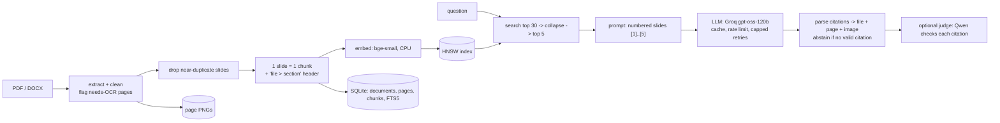

# Cornerstone

An exam-prep assistant that studies **your own slides**. Upload your course notes (PDF, DOCX); ask a question and
get a university-style answer (concise, detailed, 2-, 5- or 10-mark) in which **every sentence cites the slide it
came from** - click a citation and the slide opens. When your notes do not cover the question it says
**"Not in your notes."** instead of guessing. It also writes multiple-choice quizzes and flashcards from a unit,
each answer linked to its slide, and schedules flashcard reviews with spaced repetition (SM-2).

- Stage 1 (`v0.1-indexing`): extraction and indexing only - see the archived section at the end.
- Stage 2 (branch `stage-2`, this README): better retrieval, grounded answers, quiz + flashcards, HTTP API, CI.
  Evaluation: [`docs/evaluation-report.md`](docs/evaluation-report.md). Demo: [`docs/demo-script.md`](docs/demo-script.md).

English documents only; CPU-only laptop (Intel i5, 8 GB RAM); free-tier LLM APIs.

## Results (Stage 2; details and sources in `docs/evaluation-report.md`)

| what | metric | result | target |
|---|---|---|---|
| retrieval, test split (run once) | hit@5 | **0.939** (31/33) vs v0.1 0.879 | >= 0.90, <= 1 question worse than v0.1 (0 worse) |
| | MRR / search p95 | 0.856 / 47 ms | p95 < 1 s |
| answers, test split (run once, concise) | citation accuracy | **100.0%** (75/75) | >= 90% |
| | faithfulness (every sentence cited and supported; LLM-judged) | **96.9%** (31/32) | >= 90% |
| | "Not in your notes." on out-of-scope questions | **10/10** | >= 8/10 |
| | time to first token p50 | **0.88 s** | < 3 s |
| answers, test 5-mark sample (8 + 2) | faithfulness | **12.5% (1/8): target not met** - 6 answers had an uncited intro/conclusion, 1 an unsupported citation; the mode was fixed afterwards and measured on dev only (declared in the report) | >= 90% |
| quiz | valid questions | **100%** (25/25) | >= 95% |

What did **not** help, measured on the dev split and switched off: hybrid keyword + vector search with RRF
(hit@5 0.939 -> 0.848) and a cross-encoder reranker (no gain, p95 2.9 s). See the ablation table in the report.

## How it works



| part | file(s) |
|---|---|
| extraction, cleaning, page images | `src/cornerstone/ingest/` |
| duplicate slides, query-time collapse | `dedup.py` |
| slide chunking + context header | `chunking.py` |
| embeddings, HNSW (faiss), SQLite store, FTS5, RRF, reranker | `embeddings.py`, `index/`, `hybrid.py`, `rerank.py` |
| search (single entry point, filters by unit/document) | `search.py` |
| LLM providers (Groq, Gemini, fake for tests) | `llm.py` |
| grounded answers, modes, abstention | `answer.py` |
| citation parser + judge check | `citations.py` |
| quiz, flashcards, SM-2, study database | `quiz.py`, `flashcards.py`, `srs.py`, `study_store.py` |
| HTTP API (FastAPI) | `api.py` |
| UIs | `web/` Next.js + TypeScript + Tailwind (Documents, Ask, Quiz, Flashcards; a thin client over the API); `app/streamlit_app.py` (fallback, same features) |

Every contract (inputs, outputs, errors, edge cases) is in [`ARCHITECTURE.md`](ARCHITECTURE.md); decisions and bugs
in [`NOTES.md`](NOTES.md); examiner questions in [`VIVA.md`](VIVA.md).

## Setup (Windows 10/11 64-bit, Python 3.12)

```powershell
git clone https://github.com/amanpandey-git/corner_stone.git
cd corner_stone
git switch stage-2
py -3.12 -m venv .venv
.\.venv\Scripts\pip install -r requirements.txt      # CPU torch via the extra index in the file
copy .env.example .env                                # then put your GROQ_API_KEY (and GEMINI_API_KEY) in .env
```

`.env` is git-ignored; keys are only sent in HTTP headers and never printed, logged or cached. The embedding model
(~130 MB) downloads on first use. Groq's free tier allows 8000 tokens/minute and 200k tokens/day for the answer
model; answers are cached, so repeating a question costs nothing.

## Use it

```powershell
$env:PYTHONPATH = "src"
.\.venv\Scripts\python -m cornerstone.cli ingest samples                       # index a file or folder
.\.venv\Scripts\python -m cornerstone.cli ask "Explain SCAN disk scheduling" --mode 5-mark --check
.\.venv\Scripts\python -m cornerstone.cli search "What is a TLB?" --unit "Unit 3"
.\.venv\Scripts\python -m cornerstone.cli stats
.\.venv\Scripts\python -m cornerstone.cli compact --yes                        # drop deleted vectors
.\.venv\Scripts\python -m streamlit run app\streamlit_app.py --server.fileWatcherType none   # Ask, Quiz, Flashcards, Search, Upload
.\.venv\Scripts\python -m uvicorn cornerstone.api:app --port 8000              # API; docs at http://127.0.0.1:8000/docs
```

### Web app (two terminals; Node 24 LTS)

```powershell
# terminal 1 - the API (all the logic)
$env:PYTHONPATH = "src"; .\.venv\Scripts\python -m uvicorn cornerstone.api:app --port 8000

# terminal 2 - the web app, then open http://localhost:3000
cd web
npm ci          # first time only
npm run dev
```

The browser calls the API directly (CORS allows `http://localhost:3000` and `http://127.0.0.1:3000`, set in
`config.yaml` `api.cors_origins`). Another API address: set `NEXT_PUBLIC_API_URL` before `npm run dev`. If the web
app is not working, the Streamlit page above has every feature.

An index built by older code refuses to open and names the fix: `cli rebuild samples --yes` (the old folder is
kept as `data/index.v<N>.bak`).

## Tests and evaluation

```powershell
.\.venv\Scripts\python -m pytest -q                     # 274 tests, ~3.5 min, no API keys needed (fake provider)
.\.venv\Scripts\python eval\retrieval_eval.py --split dev
.\.venv\Scripts\python eval\answer_eval.py --split dev  # uses the real providers; paced for the free tier
.\.venv\Scripts\python eval\quiz_eval.py
```

GitHub Actions runs the test suite and the web app's lint + build on every push (`.github/workflows/tests.yml`).

## Known limitations

- No OCR: diagram-only or scanned slides are flagged "needs OCR" and not indexed; diagrams and tables are not read.
- English only. One corpus (operating-systems slides) and assistant-written questions: the numbers are evidence for
  this setup, not a general benchmark.
- Comparison questions sometimes retrieve only one side (k = 5); the answer then covers what was found and says what
  the notes do not cover.
- The citation judge is itself a language model; full answers are kept for manual spot checks.
- Free-tier limits: Gemini allows only 20 requests/day per model here, so it is an optional answer provider and the
  judge runs on Groq.
- Single user, local data; no accounts, no deployment.

## Stage 1 (archived summary)

Stage 1 (`v0.1-indexing`) built and verified the indexing pipeline: zero silent failures over 422 pages (409 with
text, 13 flagged), HNSW recall@10 0.995 vs exact search, hit@5 0.950 on its first 20 questions. Its demo runs from
branch `stage-1-stable`. Details: `eval/results/` (Stage 1 files) and the Stage 1 entries in `PROGRESS.md`.
