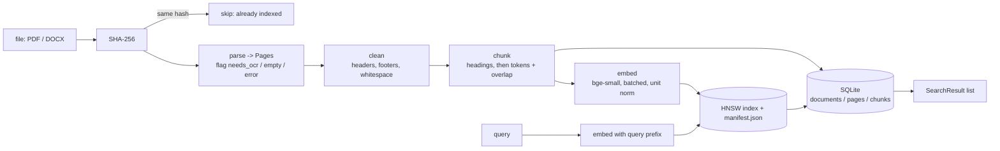

# Cornerstone

An exam-prep study assistant. Students upload notes, textbooks and past papers (PDF, DOCX); Cornerstone
extracts, cleans, chunks, embeds and indexes them so that an LLM can later answer questions with citations
and generate study material.

**Stage 1 (this release, tag `v0.1-indexing`) is extraction and indexing only.** English documents, no LLM.
It answers one question honestly: *given a student's question, does the index return the right slide?*

## What Stage 1 does

| Step | What | Where |
|---|---|---|
| Extract | PDF text with page numbers and font-size headings; DOCX heading sections with paragraph ranges (never invented page numbers); scanned/diagram pages flagged `needs_ocr` with a reason | `ingest/pdf_parser.py`, `ingest/docx_parser.py` |
| Clean | Repeated headers/footers and page numbers removed, whitespace normalised, maths symbols and ligatures kept | `ingest/cleaner.py` |
| Chunk | Split at headings first, then 256-token windows with 48 overlap; tiny fragments merged; nothing truncated | `chunking.py` |
| Embed | `BAAI/bge-small-en-v1.5` (384-d, CPU), unit-length vectors, query prefix on queries only | `embeddings.py` |
| Index | HNSW (faiss `IndexHNSWFlat`, inner product = cosine), chunk id = label, incremental, saved to disk, manifest guards model/dimension | `index/hnsw_index.py`, `index/manifest.py` |
| Store | SQLite: documents, pages, chunks; one `status` column decides what is searchable | `index/metadata_store.py` |
| Dedup | SHA-256 of file bytes: same content skipped, same name with new content replaces the old version | `pipeline.py` |
| Search | query -> top-k chunks with file, page/section, score, snippet | `search.py`, `cli.py` |

Not in Stage 1 (see `docs/future-scope.md`): LLM answers and citations, reranking, hybrid BM25, OCR, tables,
equations and images, non-English documents, quizzes and other study features.

## Architecture



Write order inside `ingest_file()`: rows stored as `pending` -> vectors added and index saved -> rows
`activate`d in one transaction (which also retires an older version of the same file name). A crash in
between leaves a `pending` document that the CLI reports and only discards with consent. Details and every
function contract: [`ARCHITECTURE.md`](ARCHITECTURE.md).

## Setup (Windows 10/11, 64-bit, CPU only)

Tested on Python 3.12.10, Intel i5-1135G7, 8 GB RAM. Python 3.14 (the system default here) was not tried; use 3.12 as tested.

```powershell
git clone https://github.com/amanpandey-git/corner_stone.git
cd corner_stone
py -3.12 -m venv .venv
.\.venv\Scripts\pip install -r requirements.txt     # torch CPU build via the extra index in the file
```

The embedding model (~130 MB) downloads on first use into the Hugging Face cache.
`hnswlib` is not used: it has no Windows wheel and needs a C++ compiler (see `NOTES.md`).

## Usage

Run from the repo root with `PYTHONPATH=src`:

```powershell
$env:PYTHONPATH = "src"
.\.venv\Scripts\python -m cornerstone.cli ingest samples            # a file or a folder of .pdf/.docx
.\.venv\Scripts\python -m cornerstone.cli search "What is a TLB?" --k 5
.\.venv\Scripts\python -m cornerstone.cli stats
.\.venv\Scripts\python -m cornerstone.cli chunks "samples\Unit 3_Memory management.pdf"   # inspect chunks
```

- `ingest` prints one line per file (pages, with text, flagged, chunks, seconds) and each flagged page with
  its reason. Exit code is 1 if any file failed.
- Index and database live in `data/index/` (git-ignored). If they disagree after a crash, the CLI says so and
  asks before discarding interrupted ingests (`--yes` to skip the question).

Verification and tests:

```powershell
.\.venv\Scripts\python -m pytest -q                                   # 105 tests, ~40 s
.\.venv\Scripts\python eval\ann_vs_bruteforce.py                      # HNSW vs exact search
.\.venv\Scripts\python eval\retrieval_eval.py --check                 # validate eval/questions.jsonl
.\.venv\Scripts\python eval\retrieval_eval.py                         # hit@5, MRR, latency
```

## Results

Measured on the 7 course PDFs in `samples/` (OS lecture slides: 422 pages), CPU only. Raw files are in
`eval/results/`. **Nothing was tuned on the evaluation questions.**

### Ingestion (zero silent failures: 409 text + 13 flagged = 422 pages)

| file | pages | with text | flagged | chunks | time (s) |
|---|---|---|---|---|---|
| Unit 1_Part 1_Introduction & OS Structure | 48 | 48 | 0 | 54 | 6.1 |
| Unit 1_Part 2_ Process management | 120 | 120 | 0 | 89 | 11.0 |
| Unit 2_Process Synchronization_Deadlock | 59 | 56 | 3 | 56 | 6.9 |
| Unit 3_Memory management | 55 | 48 | 7 | 41 | 5.6 |
| Unit 4_Storage management_ Disk Schduling | 51 | 51 | 0 | 38 | 4.2 |
| Unit 5_Part 1_File-system-interface | 61 | 60 | 1 | 32 | 2.9 |
| Unit 5_Part 2_System Protection | 28 | 26 | 2 | 18 | 2.0 |
| **total** | **422** | **409** | **13** | **328** | **38.7** |

All 13 flagged pages are `needs_ocr` (diagram or image slides), each reported with its reason. Index file
0.55 MB, SQLite 0.25 MB. Model load (~16 s) is not included in the times.

### ANN quality: HNSW vs exact search (`eval/results/ann_recall.md`)

| ef_search | recall@10 (real index, 328 vectors) | recall@10 (synthetic, 10,000 vectors) |
|---|---|---|
| 10 | 0.952 | 0.975 |
| **50 (default)** | **0.995** | **1.000** |
| 100 | 0.996 | 1.000 |

Target >= 0.95 at the default: met. The 10,000-vector run is **synthetic** (real vectors perturbed with noise)
and only shows how the graph behaves at larger size; it is not a retrieval-quality result. With 328 vectors
HNSW is not faster than a numpy scan (0.07 ms vs 0.03 ms index time); at 10,000 vectors it is about 7x faster (0.11 ms vs 0.82 ms).

### Retrieval quality on 20 labelled questions (`eval/results/retrieval_eval.md`)

| metric | value |
|---|---|
| **hit@5** | **0.950** (19 / 20) |
| **MRR** (top 10) | **0.885** |
| multi-page questions (3, two consecutive pages each) | 5 of 6 labelled pages found in the top 5 |
| end-to-end search latency p50 / p95 | 35 ms / 57 ms (query embedding + HNSW + SQLite) |

Target hit@5 >= 0.8: met. Questions and exact answering phrases: `eval/questions.jsonl`, `eval/evidence.md`.

**Read these numbers with the following caveats:**

- **One question is 5 points.** With 20 questions, a single question moves hit@5 by 0.05; the figure is
  indicative, not precise. The questions are written in natural student wording and share some words with
  slide titles, so this is not an adversarial paraphrase test.
- **The one miss is a Unit 4 duplicate case.** "Total seek time for FCFS ... head at 50" was not in the top 10.
  The answering chunk exists and is not flagged, so it is a ranking miss. The top 10 were five near-identical
  disk-scheduling slides, each present twice, because that PDF repeats its own slides 2-26 as 27-51. Duplicates
  therefore halve the effective depth. I did not change anything in response (details in `NOTES.md`).
- **`equivalent_pages` was added before the first run.** Because of those duplicated slides, the question format
  gained an optional `equivalent_pages` field: a hit on the verbatim duplicate counts, and those two questions
  are not counted as multi-page. This was decided before any result had been seen; it is logged in `NOTES.md`.
- The three questions I asked by hand while building search (deadlock conditions, process vs thread, paging and
  external fragmentation) are excluded from scoring and were not reused.

## Known limitations

- **No cross-file questions** in the evaluation: every question is answerable from one file, so retrieval
  across several documents is not measured.
- **Duplicates are not removed at ingest.** Deduplication is by whole-file SHA-256 only. Repeated slides inside
  one PDF (Unit 4) or near-identical chunks across files are indexed twice and compete for top-k slots.
- **No OCR.** Scanned or diagram-only pages are flagged `needs_ocr` and not indexed as text (text on them is
  kept for Stage 2). Diagrams, images, tables and equations are not extracted.
- **DOCX is tested only with a generated file.** No real-world DOCX is in `samples/`; extraction is verified on
  python-docx-built documents only.
- English only. Non-English documents are unsupported and not detected.
- Headings come from font size, so decks whose body text is larger than their titles can produce body lines as
  "section headings" and sections that merge repeated slide titles (page ranges of several slides).
- Multi-column reading order is best-effort. One irregularly wrapped footer variant in Unit 3 survives cleaning.
- HNSW cannot delete vectors: replaced documents are filtered at query time and stay in the index file
  (reported by `stats`). There is no compaction command.
- Single user, single process; the CLI is not safe for concurrent writers.

## Stage 2 roadmap

LLM answer generation with citations (file + page/section) and "I don't know" handling; reranking and hybrid
BM25; OCR for flagged pages; near-duplicate collapsing; multilingual queries (e.g. Hindi over English notes);
study material (quizzes, flashcards, concept maps). Extension points are in `ARCHITECTURE.md` section 9 and
`docs/future-scope.md`.

## Repository map

`ARCHITECTURE.md` contracts and decisions | `PROGRESS.md` session log | `NOTES.md` decision and bug log |
`VIVA.md` examiner questions | `config.yaml` all tunables | `src/cornerstone/` code | `tests/` 105 tests |
`eval/` verification scripts, questions, results | `samples/` the 7 course PDFs | `docs/` plan and future scope.
